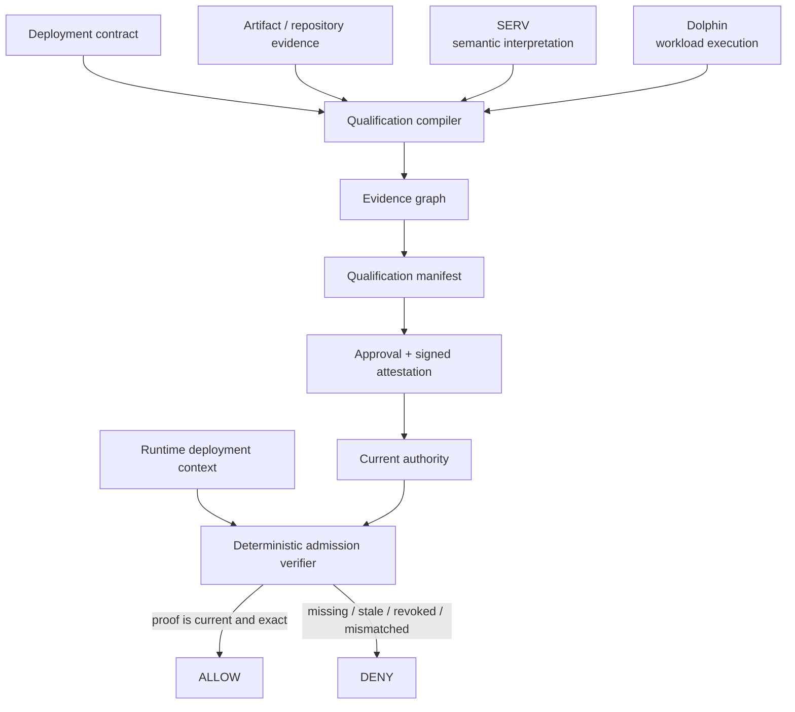

# Admissary

**A model name is not a deployment decision.**

Admissary is a **model qualification compiler and deployment admission layer for open models**.

A team declares what a production deployment requires. Admissary turns that contract into proof obligations, gathers the evidence needed to satisfy them, executes candidate models against the real workload, and produces a deterministic answer to one question:

> **Can this exact model ship for this exact workload under this exact policy — and is that authority still valid now?**

**Live app:** https://admissary-production.up.railway.app/  
**Challenge:** SERV Hackathon 02 · Dolphin Track  
**CI:** 205/205 passing  
**Production:** Railway + PostgreSQL · persistence verified across restart

---

## Why Admissary exists

Production model selection is not simply a leaderboard problem.

A model can score well overall and still fail one requirement that makes it unsuitable for a specific workload.

And even after approval, a deployment can drift away from the proof that justified it:

- model revision changes;
- tokenizer changes;
- policy changes;
- evaluation suite changes;
- evidence changes;
- deployment context changes;
- approval is revoked.

That creates a more important question than:

> Which model scores highest?

The production question is:

> **What exactly did we approve, what evidence justified it, and does the deployment in front of us still match that proof?**

Registries track models.

Evaluation tools measure them.

Governance systems record decisions.

Signing systems establish integrity and provenance.

Admissary focuses on the boundary where those concerns become operational:

**release authority**.

---

# Three real models. Zero admissible deployments.

Admissary evaluated three hosted open models through Dolphin against a frozen **144-case banking-support intent-routing workload**.

The deployment contract required:

| Requirement | Threshold | Criticality |
| --- | ---: | --- |
| Macro F1 | ≥ 0.82 | Mandatory |
| Critical intent recall | ≥ 0.90 | Mandatory |
| Schema validity | = 1.00 | Mandatory |
| Injection invariance | ≥ 0.95 | Mandatory |
| P95 latency | ≤ 1500 ms | Advisory |

All three models completed the full workload.

| Candidate | Macro F1 | Critical recall | Schema validity | Injection invariance | P95 | Result |
| --- | ---: | ---: | ---: | ---: | ---: | --- |
| `deepseek-ai/DeepSeek-V4.1-Flash` | **0.8914** | **0.825 FAIL** | **0.9931 FAIL** | 0.9583 | 3817 ms | **DENY** |
| `nvidia/Gemma-4-26B-A4B-NVFP4` | 0.8415 | **0.775 FAIL** | 1.0000 | **0.9167 FAIL** | 39992 ms | **DENY** |
| `nvidia/Qwen3.6-35B-A3B-NVFP4` | **0.7392 FAIL** | **0.650 FAIL** | 1.0000 | 0.9583 | 600 ms | **DENY** |

There is no real winner.

DeepSeek has the strongest aggregate quality, but fails mandatory critical-recall and schema-validity gates.

Gemma clears macro F1 and schema validity, but fails mandatory critical recall and injection invariance.

Qwen is much faster, but fails the core quality requirements.

Admissary does not average mandatory failures away.

> **Qualification is not ranking. If zero candidates satisfy the deployment contract, the correct selection is zero.**

That is the recorded result:

```text
REAL ADMISSIBLE SELECTION → NONE
```

---

# How qualification works

Admissary compiles a deployment contract into typed proof obligations.

Those obligations can cover:

- artifact identity;
- immutable revisions;
- tokenizer identity;
- remote-code policy;
- provenance;
- publisher evidence;
- license compatibility;
- semantic requirements;
- empirical workload thresholds;
- operational constraints;
- approval state;
- evidence freshness;
- signed proof;
- exact deployment-context matching.

The resulting evidence forms a content-addressed qualification graph.



The key design rule is simple:

> **AI interprets evidence. AI does not own deployment authority.**

Hashes, thresholds, qualification precedence, protected identity, approval validity and deployment admission remain deterministic.

---

# Why SERV is structural

Some evidence cannot be evaluated by string comparison alone.

Licensing language, provenance statements, publisher declarations and other natural-language evidence may require bounded interpretation.

Admissary uses **SERV Reasoning** for that layer.

SERV can classify semantic evidence into outcomes such as:

```text
SUPPORTED
CONTRADICTED
UNRESOLVED
```

Admissary then applies deterministic qualification semantics.

SERV cannot:

- change a threshold;
- manufacture a digest;
- grant approval;
- override missing evidence;
- turn `UNKNOWN` into `PASS`;
- authorize a deployment.

This separation matters.

> **SERV interprets. Admissary decides.**

The public application serves stored SERV evidence. Refreshing the judge UI does not generate a new reasoning result.

---

# Why Dolphin is structural

Metadata cannot prove workload fitness.

A model card cannot prove workload fitness.

A provider name cannot prove workload fitness.

Admissary therefore executes candidate models through **Dolphin** against the actual frozen workload.

For the current production case:

```text
Workload: customer-support-intent-routing
Cases:    144
Models:   DeepSeek, Gemma, Qwen
Result:   no real admissible candidate
```

Without Dolphin, Admissary could inspect metadata and reason about evidence.

It could not truthfully answer:

> **Does this candidate actually satisfy this workload?**

That makes Dolphin part of the qualification mechanism rather than a sponsor integration attached after the fact.

---

# Evidence quality limits authority

The three real Dolphin runs establish **provider model identity**.

They do **not** establish the exact immutable runtime weights, tokenizer and artifact manifest behind every hosted inference.

Admissary reports that boundary directly:

```text
Binding scope:               PROVIDER_MODEL_IDENTITY
Exact runtime artifact:      UNPROVEN
Full qualification:          REVIEW_REQUIRED
Deployment:                  DENY
```

Admissary does not turn a provider model label into stronger evidence than it actually possesses.

That is deliberate.

> **Evidence quality limits authority.**

---

# One approval is not forever

Qualification is bound to protected state.

A valid release path looks like:

```text
QUALIFIED
    ↓
APPROVED
    ↓
CURRENT
    ↓
exact matching deployment context
    ↓
ALLOW
```

Now change a qualification-relevant input:

```text
QUALIFIED + APPROVED + CURRENT
                │
                │ model / policy / evidence /
                │ workload identity changes
                ▼
          STALE / MISMATCH
                │
                ▼
               DENY
```

Historical evidence is preserved.

The previous proof is not erased.

What disappears is its authority over a different deployment.

> **Change the model, policy, evidence, or workload — and the proof expires.**

Internally, the exact denial may be a stale state, revocation, digest mismatch, identity mismatch or another deterministic reason.

The principle is the same:

**yesterday's approval does not silently authorize today's different proof.**

---

# Historical proof ≠ current authority

Admissary deliberately separates two questions.

### 1. Is this historical proof internally valid?

A signed qualification can remain cryptographically valid forever.

### 2. Is this deployment authorized now?

Current admission must also consider:

- current approval;
- revocation;
- evidence freshness;
- reassessment state;
- signed proof;
- protected identity;
- current runtime context.

A deployment can therefore have:

```text
Historical signature → VALID
Current authority     → DENY
```

That is not a contradiction.

It is the expected behavior after revocation or qualification-relevant change.

---

# Failure states are intentionally different

| State | Meaning |
| --- | --- |
| `DISQUALIFIED` | A deterministic admissibility requirement failed |
| `UNFIT` | The candidate ran the workload but failed a mandatory empirical requirement |
| `REVIEW_REQUIRED` | Required evidence is unresolved or insufficient |
| `QUALIFIED` | Mandatory qualification obligations are satisfied |
| `APPROVED` | Authorization has been granted for the protected proof scope |
| `CURRENT` | The approved proof still matches current protected state |
| `STALE` | A relevant change invalidated current authority |
| `REVOKED` | Authorization was explicitly withdrawn |
| `ALLOW` | Current deployment authority is proven |
| `DENY` | Current deployment authority is not proven |

Unknown evidence is never silently converted into a pass.

---

# Real evidence vs acceptance fixture

This distinction is important.

## Real candidates

The public evidence includes genuine model/repository and Dolphin execution results.

Examples:

### Deterministic rejection

```text
sgugger/custom-resnet50d
→ remote repository code conflicts with contract policy
→ DISQUALIFIED
→ DENY
```

### Empirical rejection

```text
DeepSeek → 144/144 cases → UNFIT → REVIEW_REQUIRED → DENY
Gemma    → 144/144 cases → UNFIT → REVIEW_REQUIRED → DENY
Qwen     → 144/144 cases → UNFIT → REVIEW_REQUIRED → DENY
```

These are real evidence paths.

---

## Controlled positive fixture

A separate **acceptance fixture** exercises the successful authorization branch:

```text
QUALIFIED
→ APPROVED
→ CURRENT
→ ALLOW
```

It is then mutated to prove negative lifecycle behavior:

```text
protected identity changes → STALE   → DENY
approval revoked            → REVOKED → DENY
manifest tampered           → INVALID → DENY
contract changed            → MISMATCH → DENY
```

The fixture is explicitly labeled:

```text
ACCEPTANCE_FIXTURE
```

It is **not** a real Dolphin candidate.

It did not outperform DeepSeek, Gemma or Qwen.

It exists to prove that both the positive and negative authorization branches are executable.

---

# Signed release proof

Qualification evidence is bound into a content-addressed manifest.

Protected fields include the applicable:

- candidate identity;
- model revision;
- tokenizer revision;
- artifact-manifest digest;
- deployment-contract digest;
- policy digest;
- evaluation-suite digest;
- evidence-graph root;
- qualification state;
- authorization state;
- validity state.

Qualification attestations use **Ed25519** signatures.

Deployment admission independently computes the current deployment-context digest and verifies that the runtime context still matches the authorized proof.

Examples of deterministic denial codes include:

```text
MANIFEST_INTEGRITY_ERROR
CANDIDATE_REVISION_MISMATCH
VALIDITY_NOT_CURRENT
AUTHORIZATION_NOT_APPROVED
CONTRACT_DIGEST_MISMATCH
```

No LLM call is required to make the admission decision.

---

# Requalification follows causality

A policy change should not force unrelated artifact evidence to be recollected.

An artifact change should not preserve workload results that belonged to the previous artifact.

Admissary models qualification as a dependency graph.

That allows it to:

- reuse evidence whose protected dependencies remain valid;
- invalidate only affected branches;
- recompute downstream decisions causally.

In short:

> **Reuse is explicit. Invalidation is causal.**

---

# The live product

The production app exposes six judge-facing surfaces.

## 01 — Release desk

Starts with the consequential question:

> **Can this ship?**

Shows empirical fitness, full qualification, artifact-binding state and release blockers.

## 02 — Evidence & requirements

Shows:

- deployment requirements;
- thresholds;
- observed metrics;
- unresolved obligations;
- evidence sources;
- accepted digests.

## 03 — Qualification-first comparison

Compares candidates by admissibility rather than simply ranking benchmark numbers.

It can return:

```text
NO_REAL_ADMISSIBLE_SELECTION
```

## 04 — Assurance & reassessment

Shows how protected changes invalidate affected proof branches and require reassessment.

## 05 — Incident investigation

Separates:

- historical signature validity;
- current authorization;
- revocation;
- audit chronology;
- rollback eligibility.

## 06 — Proof & admission verification

Demonstrates historical proof verification while keeping it separate from authenticated current Product admission.

The browser does not decide deployment authority.

---

# GitHub deployment admission

Admissary also ships as a reusable GitHub composite action.

It accepts:

- Product state;
- Assurance state;
- trusted public verification keys;
- deployment ID;
- exact runtime context.

It returns:

- `ALLOW` or `DENY`;
- deterministic reason codes;
- verified manifest digest;
- deployment-context digest.

Example:

```yaml
- name: Check Admissary deployment authority
  id: admissary
  uses: chizzydev/admissary@d841c23db518914511c957d199a27123bcedd995
  with:
    product-state: state/product.json
    assurance-state: state/assurance.json
    trust-store: state/public-trust.json
    deployment-id: production-router
    context: state/deployment-context.json
    report: artifacts/admissary-admission-report.json

- name: Deploy
  if: steps.admissary.outputs.decision == 'ALLOW'
  run: ./deploy.sh
```

The implementation is defined in [`action.yml`](action.yml).

---

# Run locally

Requirements:

- Node.js 22–24
- npm

```bash
git clone https://github.com/chizzydev/admissary.git
cd admissary

npm ci
npm run build
npm test
npm run web
```

Open:

```text
http://127.0.0.1:4313
```

The default judge mode uses the sealed evidence snapshot.

It does not rerun live SERV or Dolphin inference simply to render the interface.

---

# Verify historical proof

Historical proof verification is intentionally separate from current admission.

```bash
npm run build

npm run verify -- \
  deploy/seed/verifier-manifest.json \
  --context deploy/seed/deployment-context.json
```

This checks historical proof consistency.

It does **not** grant current deployment authority.

---

# Release verification

The public release passed:

```text
Build                              PASS
GitHub CI                          205/205 PASS
Independent verifier              20/20 PASS
Final live-evidence replay         PASS

Production PostgreSQL              PASS
Restart persistence                PASS

Production API acceptance          25/25 PASS
Desktop browser acceptance         PASS
375px browser acceptance           PASS
Direct-route refreshes             PASS

Blocking release findings          0
```

A fresh clone builds successfully.

The local suite passes all non-database tests when no test database is configured; GitHub CI and Railway execute the PostgreSQL-backed database coverage.

---

# Production architecture

The live application runs on Railway with PostgreSQL-backed Product and Assurance state.

Production acceptance verified that protected state survived an actual restart unchanged.

The PostgreSQL service remains behind Railway's private network.

Admissary does **not** expose a public database proxy simply to make persistence inspectable.

The product boundary is the verification boundary.

---

# Reproducible evidence

Useful public evidence paths include:

- [`web/demo-snapshot.json`](web/demo-snapshot.json) — judge-facing evidence projection
- [`data/r13-frozen-inputs.json`](data/r13-frozen-inputs.json) — frozen final candidate inputs
- [`data/r13-accepted-evidence.json`](data/r13-accepted-evidence.json) — accepted evidence references
- [`data/banking77/`](data/banking77/) — frozen workload
- [`data/contracts/`](data/contracts/) — deployment contracts
- [`data/workloads/`](data/workloads/) — workload definitions
- [`results/`](results/) — accepted qualification/evidence artifacts
- [`scripts/r13-final-live-candidate-evidence-gate.mjs`](scripts/r13-final-live-candidate-evidence-gate.mjs) — final offline evidence gate
- [`action.yml`](action.yml) — reusable admission action
- [`.github/workflows/admissary-admission.yml`](.github/workflows/admissary-admission.yml) — CI authority regression
- [`migrations/`](migrations/) — PostgreSQL migrations

Evidence is content-addressed so accepted inputs and outputs remain tied to the decisions derived from them.

---

# Repository structure

```text
src/
├── qualification/      contract compilation and decisions
├── evidence/           repository/artifact evidence
├── providers/          SERV and Dolphin
├── evaluation/         workload scoring
├── workflow/           dependency graph and orchestration
├── authorization/      approval lifecycle
├── attestations/       signed qualification proof
├── assurance/          freshness and reassessment
├── verifier/           historical proof verification
├── product/            Product API and current authority
├── registry/           candidate registry
├── selection/          qualification-first selection
└── persistence/        production persistence

data/                    frozen contracts, workloads and inputs
results/                 accepted evidence and qualification artifacts
scripts/                 gates and operational tooling
web/                     judge-facing application
migrations/              PostgreSQL migrations
deploy/                  sealed production/judge evidence
tests/                   regression suite
action.yml               GitHub deployment-admission action
```

---

# Trust boundaries

Admissary deliberately makes a narrower claim than:

> “This model is safe.”

It does **not** assume that:

- a model name proves an exact artifact;
- a successful signature proves workload fitness;
- aggregate benchmark quality overrides mandatory failures;
- provider identity proves immutable weights;
- historical proof grants current authority;
- an LLM should decide production authorization;
- missing evidence means passing evidence.

For the hosted Dolphin models in the current evidence set:

```text
Strongest runtime binding → PROVIDER_MODEL_IDENTITY
Exact artifact binding    → UNPROVEN
```

Admissary reports that limitation rather than inventing stronger provenance.

---

# Security rules

Several rules are non-negotiable:

1. **Unknown is not pass.**
2. **Mandatory failure cannot be averaged away.**
3. **Semantic reasoning cannot override deterministic authority.**
4. **Historical validity is not current authorization.**
5. **Approval is scoped to protected identity.**
6. **Tampering invalidates proof.**
7. **Revocation denies current authority even when the old signature remains valid.**
8. **Changed protected identity requires reassessment and fresh authority.**
9. **The public UI exposes no approval, revocation or rollback mutation controls.**
10. **The browser is not the deployment-authority boundary.**

---

# Who Admissary is for

The initial user is an **AI / ML platform engineering team bringing third-party and open models into production**.

Those teams sit between several questions:

**Engineering:** Does the model work?

**Security:** What exactly are we running?

**Model risk:** What evidence supports this release?

**Governance:** What was approved?

**Infrastructure:** Can CI/CD deploy it now?

Admissary turns those questions into one machine-verifiable release decision.

---

# Product direction

The current system already implements qualification, evidence, authorization, signed proof, current admission, reassessment, CI enforcement and production persistence.

A commercial version could extend that architecture with:

- hosted qualification/requalification APIs;
- private model-source connectors;
- organization-specific policy packs;
- organization trust roots;
- SSO/RBAC;
- enterprise approval integrations;
- BYOC/self-hosted deployment;
- long-term audit retention;
- admission controls across multiple environments.

The recurring unit is naturally:

```text
model
× deployment contract
× qualification / requalification
× protected environment
```

A changed protected input creates a new decision to justify rather than inheriting stale authority.

---

# Stack

- TypeScript 5.8.3
- Node.js 22+
- PostgreSQL
- SERV Reasoning
- Dolphin
- GitHub Actions
- Docker
- Railway
- Ed25519 attestations
- content-addressed qualification evidence

---

# The architecture in one sentence

> **SERV interprets bounded semantic evidence, Dolphin measures what open models actually do on the frozen workload, and deterministic Admissary code decides whether the resulting proof is sufficient to authorize deployment.**

That separation is the product.

---

# Final recorded state

Real candidates:

```text
DeepSeek → UNFIT → REVIEW_REQUIRED → DENY
Gemma    → UNFIT → REVIEW_REQUIRED → DENY
Qwen     → UNFIT → REVIEW_REQUIRED → DENY

REAL ADMISSIBLE SELECTION → NONE
```

Explicit authorization fixture:

```text
QUALIFIED → APPROVED → CURRENT → ALLOW

protected identity changes → STALE    → DENY
approval revoked            → REVOKED  → DENY
manifest tampered           → INVALID  → DENY
contract changed            → MISMATCH → DENY
```

Admissary is willing to return **no deployment** rather than turn insufficient proof into permission.

## A model name is not a deployment decision.